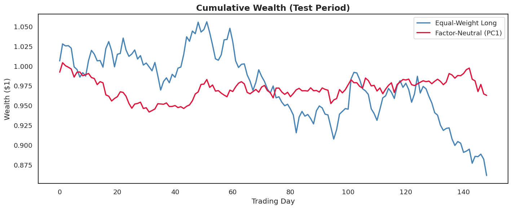
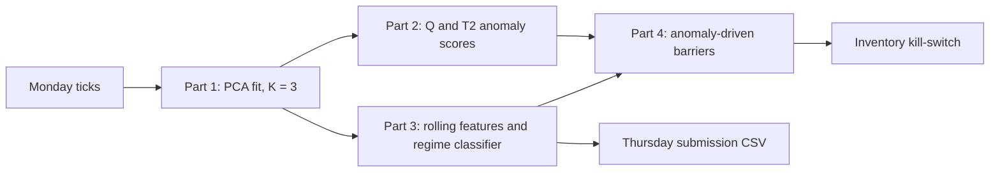
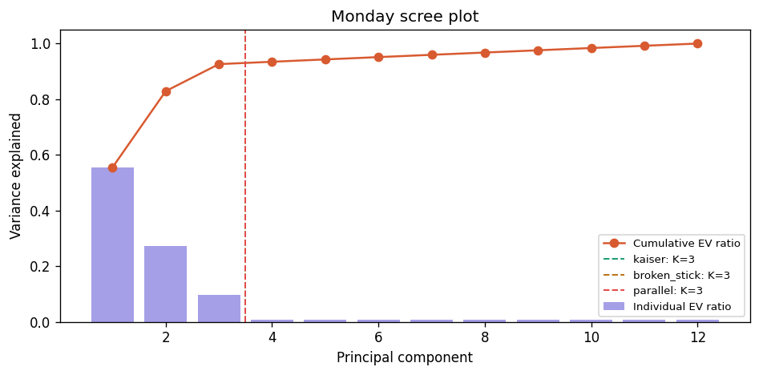
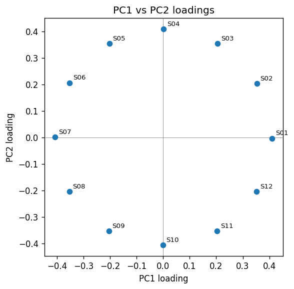
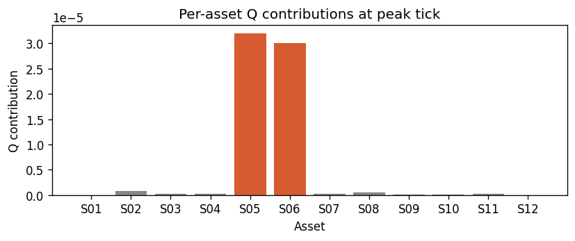
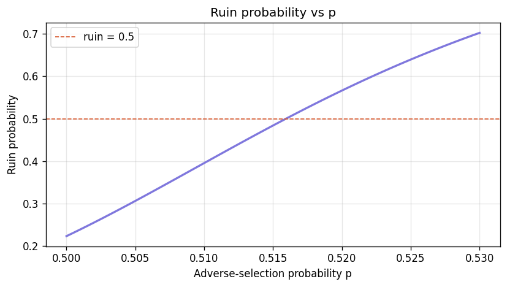

# PCA Factor Models and the Phantom Lattice: JPMorgan QMP Case Study (Team 6)

Two linked quantitative problems from the JPMorgan Chase QMP 2026 case study, solved end to end in Python:

1. **Problem Statement 1: PCA factor models in finance.** Build and stress-test a PCA factor model on synthetic equity returns, from covariance structure to factor-neutral portfolios and rolling-window stability.
2. **Problem Statement 2: The Phantom Lattice.** Discover the hidden factor structure of a 12-asset order book, detect anomalies in real time, classify market regimes, and derive a closed-form inventory kill-switch for a market-making engine.

| | |
|---|---|
| **Language** | Python 3.13 (NumPy, pandas, SciPy, scikit-learn, Numba, matplotlib) |
| **Format** | Two Jupyter notebooks plus a modular `src/` package for Problem Statement 2 |
| **Problem statement** | [`QMP26 PROBLEM STATEMENTS 1.pdf`](problem%20statement/QMP-Case%20study%20%28PS%2Bdata%29/QMP26%20PROBLEM%20STATEMENTS%201.pdf) |
| **Team** | Team 6 |

---

## Contents

- [Problem Statement 1: PCA factor models](#problem-statement-1-pca-factor-models)
- [Problem Statement 2: The Phantom Lattice](#problem-statement-2-the-phantom-lattice)
- [Known limitations](#known-limitations)
- [Getting started](#getting-started)
- [Repository structure](#repository-structure)

---

## Problem Statement 1: PCA factor models

**Notebook:** [`Problem_Statement_1/Team_6.ipynb`](Problem_Statement_1/Team_6.ipynb) · 6 parts, 40 marks

**Setup.** Ten synthetic stocks and 500 trading days are generated from a single-factor model, with a fixed random seed:

```
P(i,t) = P(i,t-1) · exp( μᵢ + βᵢ·f(t) + εᵢ(t) )        r(i,t) = μᵢ + βᵢ·f(t) + εᵢ(t)
```

Because the log return is exactly linear in the factor, PCA is the natural tool: the covariance matrix is `Σ = ββᵀσ_f² + D`, a rank-1 factor term plus a diagonal idiosyncratic term.

| Part | Topic | What was done |
|---|---|---|
| 1 | Returns and covariance | Derived `Σ` and the correlation formula, checked them against the empirical matrices, and proved `Cov(z) = Corr(r)` after standardisation. |
| 2 | PCA and eigendecomposition | Ran PCA on correlation and covariance matrices, read the loadings against the true betas, and showed that loadings and scores are different objects. |
| 3 | Reconstruction | Rebuilt returns from `k` components, showed the error equals the average discarded eigenvalue (Eckart–Young), and compared correlation structure at `k = 3`. |
| 4 | Information leakage | Fitted PCA on train only, then on all data, and quantified the gap in test explained variance. |
| 5 | Factor-neutral portfolios | Built dollar-neutral, PC1-neutral weights with a Lagrangian, backtested them out of sample, and added a PC2 constraint and a transaction-cost model. |
| 6 | Stability and rolling PCA | Ran a split-half stability test, rolling PCA with sign-flip correction, a simulated sector rotation, and a walk-forward versus oracle backtest. |

### Key results

| Finding | Result |
|---|---|
| PC1 share of variance (correlation PCA) | **46.5 %**; 6 components are needed to pass 80 % (84.6 %) |
| PC1 score vs the true latent factor | correlation **0.95** |
| PC1 loadings vs true betas | all the same sign; `corr(abs(loading), β) = 0.76` |
| Leakage (train-only vs fit-on-all PCA) | test explained variance is overstated by up to **2.82 pp** (at `k = 4`) |
| Split-half stability, `abs(cos θ)` | PC1 **0.994**, PC2 0.535, PC3 0.137 |
| Walk-forward vs oracle hedge (Sharpe) | −0.378 vs −0.224, a gap of **0.154** that measures the cost of estimation lag |

**Factor-neutral backtest (test period, 149 days)**

| Metric | Equal-weight long | PC1-neutral | PC1 + PC2-neutral |
|---|---|---|---|
| Annualised volatility | 18.61 % | **9.06 %** | 9.02 % |
| Sharpe ratio | −1.36 | −0.71 | −0.63 |
| Maximum drawdown | −18.40 % | **−6.21 %** | n/a |
| Cumulative return | −13.86 % | −3.73 % | n/a |



**Takeaways**

- Neutralising PC1 halves volatility and cuts the drawdown by about two thirds, but it does not create return: all strategies stay negative because the target weights carry no signal. Hedging removes beta; it does not add alpha.
- Adding a PC2 constraint barely reduces risk (9.06 % to 9.02 %), so over-constraining on minor factors is not worth the concentration it forces.
- Monthly rebalancing needs only **13.6 %** turnover. At 5 bps this costs about **0.08 % a year**, which fits PC1 being stable.
- A neutral portfolio is neutral only for the loadings it was built on. After the simulated sector rotation the PC1 loadings swap roles and a static hedge becomes unhedged.

---

## Problem Statement 2: The Phantom Lattice

**Notebook:** [`Problem_Statement_2/Team_6.ipynb`](Problem_Statement_2/Team_6.ipynb) · 4 parts plus an optional bonus, 47 marks
**Code:** [`Problem_Statement_2/src/`](Problem_Statement_2/src/)

**Data.** Four days of tick returns for 12 assets (about 28,000 ticks per day, in [`data/`](Problem_Statement_2/data/)):

| Day | Role |
|---|---|
| Monday | Clean calibration week for the factor model |
| Tuesday | Contains an anomaly after 13:00, used for detection |
| Wednesday | Labelled with four regimes (`NORMAL`, `FAT_FINGER`, `SECTOR_ROTATION`, `CORRELATION_BREAK`) |
| Thursday | Unlabelled; the regime predictions are the submission |

### System design



| Module | Part | Responsibility |
|---|---|---|
| `p1_blind_cartographer.py` | 1 | Load and pivot ticks, fit Monday PCA, choose `K` (Kaiser, broken-stick, Horn's parallel analysis), loading geometry, leakage test, neutrality check |
| `p2_sentinel_detector.py` | 2 | Static Q and T² scores, Jackson–Mudholkar and F-distribution limits, per-asset contributions, Numba streaming PCA (`StreamingPCADetector`), Isolation Forest and MCD comparison |
| `p3_regime_classifier.py` | 3 | Rolling covariance engine with rank-1 updates, seven streaming features, threshold calibration, rule-based classifier with 5-tick hysteresis, submission writer |
| `p4_model_shootout.py` | 4 | Gambler's-ruin closed form, estimation of the adverse-selection probability `p`, inventory simulator, fixed and anomaly-driven barriers, skew policies. The file name is historical; it holds the kill-switch logic. |
| `p5_backtester.py` | 3 | Wednesday backtest with the tuned thresholds and Thursday submission generator |
| `bonus_pipeline.py` | Bonus | `PhantomLatticePipeline`: one streaming object wiring Parts 1 to 4, with JSON telemetry |

### Part 1: The Blind Cartographer

- **`K = 3`.** Kaiser, broken-stick and Horn's parallel analysis all agree, so `K = 3` is used in every later part.
- **Geometry.** The (PC1, PC2) loadings of the 12 assets sit at the vertices of a regular 12-gon. Rotating the axes changes the per-axis variance but not the joint variance, which is the rotation ambiguity.
- **Neutrality proof.** The equal-weight portfolio is factor-neutral because the 12th roots of unity sum to zero. Numerically its loadings are 2.8e-4 on PC1 and 3.2e-4 on PC2.
- **Leakage.** Explained variance on Tuesday is 0.867043 with a Monday-only fit and 0.867079 with a leaky fit, a gap of 3.6e-5. The gap is small here because the factor structure is stable. It would grow after a structural break.

<p align="center">
  
  
</p>

### Part 2: The Sentinel

Two statistics are computed against the Monday model: **Q** (squared prediction error, movement outside the 3-factor subspace) and **Hotelling's T²** (movement inside it).

| Item | Result |
|---|---|
| Q limit | 2.0e-6 (empirical and Jackson–Mudholkar agree) |
| T² limit | 11.50 empirical, 11.35 from the F distribution |
| Peak-Q tick on Tuesday | 13:54:34, with the contribution concentrated in assets **S05 and S06** |
| Streaming detector latency | mean **2.6 µs**, p99 18.3 µs, p99.9 22.7 µs, max 57.6 µs per tick (target: 50 µs) |

**Model shootout**

| Method | Detection latency (ticks) | Monday false-positive rate | Mean time per tick |
|---|---|---|---|
| Static PCA (Q) | 0 | 0.010 | one matrix projection (not timed) |
| Streaming PCA (Q) | 0 | n/a (cold start on Tuesday) | **2.6 µs** |
| Isolation Forest (raw 12-D) | 43 | 0.0117 | 4,109 µs |
| Mahalanobis (MCD) | 0 | 0.011 | 102 µs |

**Recommendation: static PCA with the Q statistic and a Jackson–Mudholkar limit.** It is fast, its score is additive across assets so a breach can be traced to the responsible asset, and a fixed baseline does not slowly adapt to an ongoing break the way streaming PCA does. The streaming version is the choice when the market's normal state is expected to drift.



### Part 3: The Regime Hunt

Seven features are computed per tick from a **100-tick rolling window**: PC1 and PC2 explained-variance ratios, mean correlation, Q, principal angle to Monday's subspace, the largest single-asset share of Q, and the change in PC1 variance ratio. A rule cascade turns them into a regime (highest priority first):

1. **`FAT_FINGER`**: one asset dominates a large Q.
2. **`CORRELATION_BREAK`**: the rolling subspace has rotated away from Monday's by more than a threshold angle.
3. **`SECTOR_ROTATION`**: the PC1 variance share has shifted.
4. **`NORMAL`**: otherwise.

A 5-tick hysteresis stops the label from flickering.

| Wednesday result | Macro-F1 |
|---|---|
| Notebook (the Thursday submission file) | **0.9409** |
| `p5_backtester.py` with hand-tuned thresholds (FF 0.42, CR 45°, SR 0.10) | **0.9466** (accuracy 95.6 %) |

Per class in the notebook run:

| Regime | Precision | Recall | F1 |
|---|---|---|---|
| NORMAL | 0.93 | 0.99 | 0.96 |
| FAT_FINGER | 1.00 | 0.90 | 0.95 |
| SECTOR_ROTATION | 0.97 | 0.90 | 0.93 |
| CORRELATION_BREAK | 0.97 | 0.89 | 0.93 |

Wednesday is also the calibration set, so these scores are in-sample (see [Known limitations](#known-limitations)). The tuning history is in [`experiment_log.md`](experiment_log.md). `SECTOR_ROTATION` is the hardest regime to detect: it changes how variance is split between factors without adding an outlier asset or rotating the eigenvectors.

### Part 4: The Kill-Switch

The market maker's inventory is modelled as a random walk with absorbing barriers at ±40. If a latency disadvantage makes the next fill adverse with probability `p`, each excursion away from zero is a gambler's-ruin problem, and ruin over `T` round trips is `1 − (1 − Pᵣ)ᵀ` with the closed form `Pᵣ = (1 − q/p) / (1 − (q/p)ᵁ)`.

- **Steepness.** Ruin crosses 50 % at `p* ≈ 0.516` and the curve is very steep around it, so a half-point of adverse selection decides whether the desk survives.
- **`p` from data.** `p` is estimated from the fill stream. On Tuesday `p̂ = 0.497 ± 0.004` (17,472 fills), which implies a ruin probability of about 0.18.
- **`p` by regime on Wednesday.** NORMAL 0.500, SECTOR_ROTATION 0.488, CORRELATION_BREAK 0.508, **FAT_FINGER 0.565**. Adverse selection is concentrated in fat-finger events.
- **Dynamic barriers.** When the Part 2 detector fires, the barriers tighten from ±40 to ±20.



### Bonus: The Full Stack

`PhantomLatticePipeline` takes tick chunks and, at each step, updates the PCA model, scores Q and T², classifies the regime, adjusts the barriers, updates inventory and emits JSON telemetry events (`ALERT`, `REGIME_CHANGE`, `ABSORBED`, `SUMMARY`). `run_live_demo` replays the first hour of Thursday (4,012 ticks in 40 chunks of about 100).

---

## Known limitations

These come from re-running both notebooks and the backtester from a clean environment.

- **Wednesday scores are in-sample.** The thresholds are calibrated on the labelled Wednesday data (10th percentile of each regime's feature distribution) and then tuned by hand on the same labels. The Thursday score is unknown because its labels are hidden.
- **Dynamic barriers did not reduce ruin in the synthetic ensemble.** Over 1,000 simulated Tuesday sessions, ruin was **23.2 %** with fixed barriers and **27.7 %** with anomaly-driven barriers. This is consistent with tighter barriers being easier to hit, so the barrier policy needs more tuning. The notebook's written discussion claims a reduction from 48 % to about 10 %, which its own output does not show.
- **The bonus demo ends in a kill-switch event.** In the demo run the alert at tick 500 tightened the barriers while inventory was +27, so the kill switch fired (verdict `RUIN`).
- **Latency.** The streaming detector averages 2.6 µs per tick, with a worst case of 57.6 µs against the 50 µs target.
- **`p5_backtester.py` overwrites the notebook's submission.** `Team_6_submission.csv` in the repository is the notebook's output. Re-running `p5_backtester.py` writes its own predictions, from the hand-tuned thresholds, straight over that same path. The two disagree on about 4.5 % of rows, so commit or copy the file you want before re-running.
- **Cosmetic.** Some saved notebook outputs contain warnings with the authors' local file paths, and `bonus_pipeline.py` triggers a pandas `"1H"` deprecation warning.

---

## Getting started

**Requirements:** Python 3.11+ and the packages in [`requirements.txt`](requirements.txt). Use **pandas 2.x**: the Problem Statement 2 notebook calls `index.round("S")`, which pandas 3 no longer accepts.

```bash
# 1. Environment
python -m venv .venv && source .venv/bin/activate
pip install -r requirements.txt

# 2. Problem Statement 1 (self-contained, generates its own data)
jupyter nbconvert --to notebook --execute --inplace Problem_Statement_1/Team_6.ipynb

# 3. Problem Statement 2: run from inside its folder so ./src and ./data resolve
cd Problem_Statement_2
jupyter nbconvert --to notebook --execute --inplace Team_6.ipynb

# 4. Optional: re-run the Wednesday backtest and write a Thursday CSV
python src/p5_backtester.py
```

`p5_backtester.py` appends a row to `Problem_Statement_2/experiment_log.md` and overwrites `Problem_Statement_2/Team_6_submission.csv`. Note that it also runs `git add` and `git commit` on every run, with no opt-in flag, so run it on a clean branch if you do not want the commit.

Numba compiles the streaming kernel on first use and caches it, so the first run of the Part 2 cells is slower.

---

## Repository structure

```
.
├── README.md
├── requirements.txt
├── experiment_log.md                       # threshold tuning history
├── problem statement/
│   └── QMP-Case study (PS+data)/
│       └── QMP26 PROBLEM STATEMENTS 1.pdf  # the original problem statements
├── assets/                                 # figures used in this README
├── Problem_Statement_1/
│   └── Team_6.ipynb                        # PCA factor models, 6 parts
└── Problem_Statement_2/
    ├── Team_6.ipynb                        # Phantom Lattice, 4 parts + bonus
    ├── Team_6_submission.csv               # Thursday regime predictions (notebook)
    ├── data/                               # Monday to Thursday ticks, Wednesday labels
    └── src/
        ├── p1_blind_cartographer.py
        ├── p2_sentinel_detector.py
        ├── p3_regime_classifier.py
        ├── p4_model_shootout.py            # kill-switch and inventory logic
        ├── p5_backtester.py
        └── bonus_pipeline.py
```

---

*Prepared by Team 6 for the JPMorgan Chase QMP 2026 case study.*
